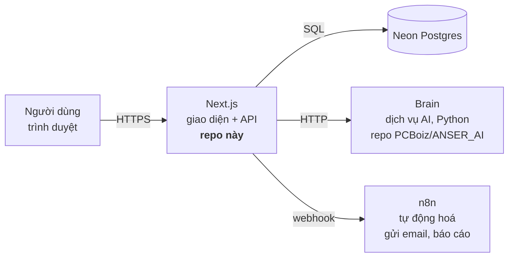
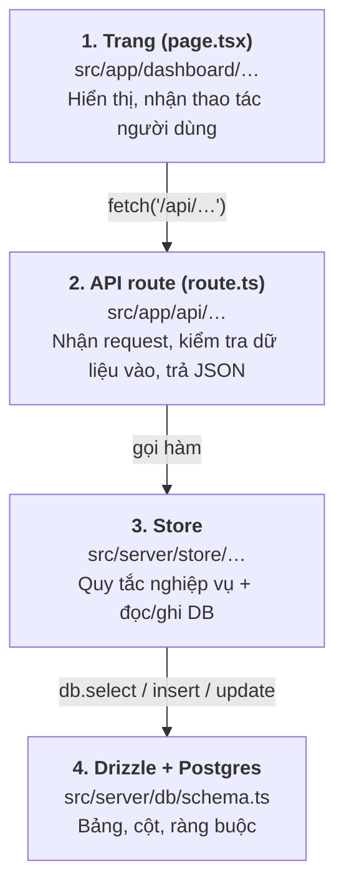
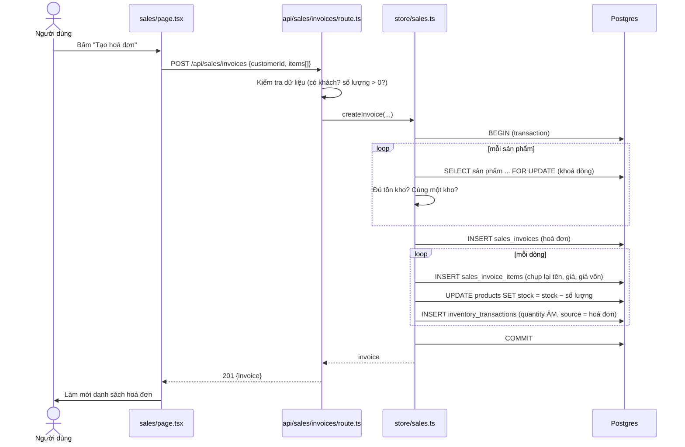

# ANSER-v2 — Sổ tay cho thành viên mới

> Cập nhật 22/10/2026
> Dành cho người **mới vào dự án** hoặc **mới làm quen với lập trình web**. Không cần đọc
> các tài liệu khác trước — tài liệu này dẫn bạn đi từng bước, và chỉ sang tài liệu khác
> khi bạn cần đào sâu.
>
> **Mốc code được mô tả**: `master` **sau khi** đã merge nhánh `feat/database-application`
> (có tính năng "Nhập Excel", migration `0013`/`0014`, CI). Nếu bạn đọc lúc PR merge đó
> chưa vào `master`, vài file nhắc tới bên dưới (`src/server/import/`, `.github/workflows/ci.yml`)
> chỉ có trên nhánh `feat/database-application`.

## Mục lục

1. [Dự án này là gì — trong 2 phút](#1-dự-án-này-là-gì--trong-2-phút)
2. [Cài đặt và chạy trên máy bạn](#2-cài-đặt-và-chạy-trên-máy-bạn)
3. [Code được tổ chức thế nào](#3-code-được-tổ-chức-thế-nào)
4. [Đi theo một yêu cầu thật: tạo hoá đơn bán hàng](#4-đi-theo-một-yêu-cầu-thật-tạo-hoá-đơn-bán-hàng)
5. [Công thức cho các việc hay gặp](#5-công-thức-cho-các-việc-hay-gặp)
6. [Nghiệp vụ của khách hàng](#6-nghiệp-vụ-của-khách-hàng)
7. [Từ điển thuật ngữ](#7-từ-điển-thuật-ngữ)
8. [Những điều KHÔNG BAO GIỜ làm](#8-những-điều-không-bao-giờ-làm)
9. [Đọc gì tiếp theo](#9-đọc-gì-tiếp-theo)

---

## 1. Dự án này là gì — trong 2 phút

**ANSER Web v2** là phần mềm quản lý **kho hàng + bán hàng** cho **Hoàng Phát** — một công
ty nhỏ (3–5 người) phân phối dầu nhớt ở Hà Nội. Chủ công ty là chú Quyết.

Hằng ngày, công ty cần:

- biết **còn bao nhiêu hàng** trong kho (tính cả số lẻ — dầu bán theo lít),
- **bán hàng**: lập hoá đơn, trừ kho, ghi doanh thu,
- **nhập hàng**: cộng kho, ghi giá vốn,
- xem **báo cáo**, nhận **cảnh báo** (ví dụ sắp hết hàng).

Kế toán của công ty đang dùng phần mềm **MISA**. Dữ liệu thật của khách (danh sách hàng hoá,
khách hàng, nhà cung cấp, báo cáo tồn kho) đi vào hệ thống của mình qua các file Excel xuất
từ MISA.

Toàn bộ hệ thống gồm 3 phần chạy riêng:



- **Repo này** chỉ chứa phần **Next.js** — vừa là giao diện, vừa là backend (API). Không có
  project backend riêng.
- **Brain** (AI: chat, đọc hoá đơn, soát sổ sách) do một đội khác làm, repo khác. Không có
  Brain thì app vẫn chạy, chỉ các tính năng AI báo "chưa cấu hình".
- **n8n** chạy các quy trình tự động (gửi email báo cáo, cảnh báo tồn kho). Cũng là tuỳ chọn
  khi chạy ở máy.

Vì sao chọn kiến trúc này: xem `STACK_DECISIONS.md` (không bắt buộc đọc ngay).

---

## 2. Cài đặt và chạy trên máy bạn

### 2.1 Cần cài gì

| Công cụ | Phiên bản | Ghi chú |
|---|---|---|
| **Node.js** | ≥ 20.9 (CI dùng 24) | Kiểm tra: `node -v` |
| **pnpm** | bản mới | `corepack enable` rồi `corepack prepare pnpm@latest --activate`, hoặc cài theo hướng dẫn trên pnpm.io |
| **Git** | bất kỳ | — |
| Docker | tuỳ chọn | Chỉ cần nếu muốn chạy n8n ở máy |

Bạn **có thể** dùng npm/yarn/bun để cài, nhưng repo chỉ giữ **một** lockfile:
`frontend/pnpm-lock.yaml`. Nếu bạn thêm/bỏ thư viện, **phải** chạy `pnpm install` một lần và
commit file `pnpm-lock.yaml` mới — không thì CI báo đỏ. Đừng commit `package-lock.json`,
`yarn.lock`, `bun.lock` (đã có `.gitignore` chặn, và CI cũng chặn).

### 2.2 Lấy code

```bash
git clone https://github.com/Dgsonn/ANSER-v2.git
cd ANSER-v2/frontend
pnpm install
```

> **Lưu ý cho máy Windows**: repo có `.gitattributes` ép mọi file text về line ending `LF`.
> Hãy để editor của bạn dùng `LF` (VS Code: góc dưới bên phải, chữ `CRLF` → đổi thành `LF`).
> Nếu không, `git status` sẽ báo hàng loạt file "bị sửa" mà thật ra chỉ khác ký tự xuống dòng.

### 2.3 Tạo file `frontend/.env.local`

File này chứa **bí mật** (mật khẩu database, khoá JWT). Nó **không bao giờ** được commit —
`.gitignore` đã chặn sẵn. Tạo file `frontend/.env.local` với nội dung:

```bash
# --- BẮT BUỘC ---
# Chuỗi kết nối tới Neon Postgres. Xin trưởng nhóm quyền vào project Neon.
# Dùng branch "dev" (hoặc branch riêng của bạn tách từ dev) — KHÔNG dùng "production".
DATABASE_URL=postgresql://<user>:<password>@<host>/<db>?sslmode=require

# Khoá ký phiên đăng nhập. Tạo một chuỗi ngẫu nhiên, ví dụ: openssl rand -base64 32
JWT_SECRET=<chuỗi-ngẫu-nhiên-dài>

# Bật tạo dữ liệu mẫu + tài khoản demo khi server khởi động.
# CHỈ bật ở máy dev. Không bao giờ bật ở production (xem mục 8).
ENABLE_STARTUP_SEED=true

# --- TUỲ CHỌN: AI (Brain) ---
# BRAIN_URL=http://localhost:8000
# BRAIN_API_TOKEN=
# BRAIN_CHAT_TIMEOUT_MS=60000
# BRAIN_KB_WORKSPACE=

# --- TUỲ CHỌN: n8n ---
# N8N_WEBHOOK_URL=http://localhost:5679/webhook
# N8N_API_URL=http://localhost:5679        # KHÔNG thêm /api/v1 — code tự nối
# N8N_API_KEY=
# N8N_NOTIFY_EMAIL=
```

Không có `DATABASE_URL` thì app **dừng ngay** khi khởi động (`src/server/db/client.ts` cố ý
ném lỗi) — đó là đúng, không phải bug.

**Về branch Neon**: Neon cho phép tạo "branch" của database giống branch của git. Dự án có
branch `production` (dữ liệu thật) và `dev` (để thử nghiệm). Nếu bạn sắp thử migration, tốt
nhất tạo branch riêng tách từ `dev` (ví dụ `dev-<tên-bạn>`) để không làm hỏng dữ liệu của
người khác. Hỏi trưởng nhóm trước khi chạy migration lên `dev` dùng chung.

### 2.4 Tạo bảng trong database (migration)

```bash
pnpm db:migrate
```

Lệnh này chạy các file SQL trong `src/server/db/migrations/` lên database ở `DATABASE_URL`.
Nếu branch Neon của bạn đã có đủ bảng rồi, lệnh không làm gì cả.

### 2.5 Chạy app

```bash
pnpm dev
```

Mở <http://localhost:3000>. Ở trang đăng nhập, bấm **"Tài khoản demo"**
(`demo@anser.dev` / `demo1234`, quyền admin). Tài khoản này chỉ được tạo khi
`ENABLE_STARTUP_SEED=true`.

### 2.6 Kiểm tra trước khi đẩy code

```bash
pnpm lint          # ESLint — CI chạy đúng lệnh này
npx tsc --noEmit   # kiểm tra kiểu TypeScript
```

CI (`.github/workflows/ci.yml`) hiện kiểm: chỉ có một lockfile, cài đặt đúng lockfile, và
ESLint. CI **chưa** chạy `pnpm build` (vì build cần database).

### 2.7 (Tuỳ chọn) Chạy n8n ở máy

```bash
cd frontend
docker compose up -d
```

n8n ở <http://localhost:5679>, hộp thư giả MailHog (xem email n8n "gửi") ở
<http://localhost:8026>. Các workflow mẫu và cách nạp chúng: `frontend/n8n-workflows/README.md`.

### 2.8 Gặp lỗi thường gặp

| Triệu chứng | Nguyên nhân | Cách xử |
|---|---|---|
| `DATABASE_URL is not set` | Thiếu `frontend/.env.local` hoặc đặt sai thư mục | File phải nằm trong `frontend/`, không phải thư mục gốc |
| Không có nút/tài khoản demo đăng nhập được | `ENABLE_STARTUP_SEED` chưa bật | Thêm `ENABLE_STARTUP_SEED=true`, khởi động lại `pnpm dev` |
| `Cannot read properties of null (reading 'matches')` khi `npm install` | `node_modules` cũ do pnpm tạo | `rm -rf node_modules` rồi cài lại |
| CI đỏ ở bước `--frozen-lockfile` | Đổi `package.json` mà chưa cập nhật `pnpm-lock.yaml` | Chạy `pnpm install`, commit lockfile |
| `git status` báo `brain.ts` bị sửa dù bạn không đụng | File này được commit với line ending CRLF từ trước | Kệ nó, **đừng commit**. Xem `BLOCKERS.md` |
| Code mẫu Next.js trên mạng không chạy | Dự án dùng **Next.js 16** — nhiều API đã đổi | Đọc tài liệu đi kèm trong `frontend/node_modules/next/dist/docs/` (xem `frontend/AGENTS.md`) |

---

## 3. Code được tổ chức thế nào

### 3.1 Bản đồ thư mục (chỉ những chỗ bạn sẽ đụng)

```
ANSER-v2/
├── 0. … 6. *.md            Tài liệu dự án (đánh số theo thứ tự ra đời)
├── BLOCKERS.md             Những việc đang chờ khách/đội khác xác nhận
├── ARCHITECTURE.md         Bản đồ chi tiết từng file (đọc khi cần tra)
└── frontend/               ← TOÀN BỘ CODE ở đây
    ├── .env.local          Bí mật của bạn (tự tạo, không commit)
    ├── drizzle.config.ts   Cấu hình công cụ migration
    ├── n8n-workflows/      Workflow n8n mẫu (JSON)
    └── src/
        ├── app/            ← GIAO DIỆN + API (1 thư mục = 1 đường dẫn URL)
        │   ├── dashboard/      Các trang sau đăng nhập: /dashboard/sales, /dashboard/products, …
        │   ├── login/, register/
        │   └── api/            Backend: /api/sales/invoices, /api/products, …
        │       └── …/route.ts  Mỗi file export hàm GET/POST/PATCH/DELETE
        ├── components/     Khối giao diện dùng lại (Sidebar, bảng, biểu đồ…)
        ├── instrumentation.ts  Chạy 1 lần khi server khởi động (seed dữ liệu mẫu)
        └── server/         ← LOGIC phía server (không bao giờ chạy trên trình duyệt)
            ├── db/
            │   ├── schema.ts       ★ ĐỊNH NGHĨA MỌI BẢNG — "sự thật duy nhất"
            │   ├── client.ts       Kết nối database (`db`)
            │   └── migrations/     File SQL sinh ra từ schema.ts — KHÔNG sửa tay
            ├── store/          Hàm đọc/ghi database theo từng nghiệp vụ
            │   ├── sales.ts        Bán hàng
            │   ├── products.ts     Sản phẩm
            │   ├── inventory.ts    Nhập/xuất/điều chỉnh kho
            │   └── …
            ├── import/         Tính năng "Nhập Excel" từ file MISA
            ├── session.ts      Lấy người dùng đang đăng nhập
            ├── reports.ts      Số liệu cho trang chủ & báo cáo
            └── brain.ts        Gọi sang dịch vụ AI
```

### 3.2 Bốn tầng, đi từ trên xuống

Gần như mọi tính năng đều đi qua đúng 4 tầng này:



| Tầng | Trách nhiệm | KHÔNG làm |
|---|---|---|
| Trang | Vẽ giao diện, gọi API | Không truy cập DB trực tiếp (trừ trang server component đọc báo cáo) |
| API route | Đọc body, kiểm tra hợp lệ, kiểm tra đăng nhập/quyền, đổi lỗi thành mã HTTP (400/404/409…) | Không chứa quy tắc nghiệp vụ dài |
| Store | Quy tắc nghiệp vụ (đủ tồn kho không? giá bao nhiêu?), giao dịch DB | Không biết gì về HTTP |
| Schema | Hình dạng dữ liệu + ràng buộc ở tầng DB | — |

Một vài khái niệm bạn sẽ gặp:

- **"use client"** ở đầu file trang = trang chạy trên trình duyệt (có `useState`, nút bấm…).
  Không có dòng đó = **server component**, chạy trên server, được phép gọi thẳng hàm server
  (ví dụ `dashboard/page.tsx` gọi `getReportSummary()`).
- **Drizzle ORM**: thư viện để viết truy vấn SQL bằng TypeScript.
  `db.select().from(products).where(eq(products.id, id))` ≈ `SELECT * FROM products WHERE id = …`.
- **Transaction** (`db.transaction(async (tx) => …)`): một nhóm lệnh ghi DB hoặc **thành công
  hết**, hoặc **không lệnh nào có hiệu lực**. Dùng cho mọi thao tác ghi nhiều bảng cùng lúc
  (ví dụ: tạo hoá đơn + trừ kho + ghi sổ kho).
- **Đăng nhập**: JWT lưu trong cookie `httpOnly`. Ở server, lấy người dùng hiện tại bằng
  `getSessionUser()` (`src/server/session.ts`). Có 3 quyền: `staff`, `manager`, `admin`.
  **Lưu ý**: hiện nhiều API route **chưa** kiểm tra đăng nhập — đây là hạn chế đã biết
  (`ARCHITECTURE.md` §7), không phải mẫu để bắt chước. Route mới **phải** kiểm tra.

---

## 4. Đi theo một yêu cầu thật: tạo hoá đơn bán hàng

Cách nhanh nhất để hiểu code là đi theo một thao tác từ đầu đến cuối. Người dùng vào trang
**Bán hàng**, chọn khách, chọn 2 sản phẩm, bấm **"Tạo hoá đơn"**.



### Bước 1 — Trang: `frontend/src/app/dashboard/sales/page.tsx`

- Khi mở trang, `load()` gọi song song 4 API: sản phẩm, hoá đơn gần đây, khách hàng, kho.
- Người dùng chọn sản phẩm/số lượng → lưu trong state `items`.
- `handleSubmit()` gửi `POST /api/sales/invoices` với JSON `{ customerId, customerName, note, items }`.
- Nếu API trả lỗi, hiện `data.message` (tiếng Việt, do server soạn sẵn).

### Bước 2 — API route: `frontend/src/app/api/sales/invoices/route.ts`

- Hàm `POST` đọc body, **kiểm tra hợp lệ**: phải có khách (chọn sẵn hoặc gõ tên khách vãng
  lai), danh sách sản phẩm không rỗng, mỗi số lượng là số dương.
- Nếu chọn khách có sẵn, lấy lại tên khách từ DB (không tin tên do trình duyệt gửi lên).
- Gọi `createInvoice(...)` trong store.
- **Đổi lỗi thành mã HTTP**: không tìm thấy sản phẩm → `404`; không đủ hàng / khác kho → `409`;
  lỗi khác → `500`. Store ném lỗi có kiểu riêng (`InsufficientStockError`,
  `CrossWarehouseError`…), route bắt từng loại.

### Bước 3 — Store: `frontend/src/server/store/sales.ts` → `createInvoice()`

Đây là phần quan trọng nhất. Đọc chậm, từng đoạn:

1. **Gộp dòng trùng sản phẩm** — chọn cùng một sản phẩm ở 2 dòng thì kiểm tra tồn kho theo
   **tổng** số lượng.
2. **Mở transaction** — mọi thứ bên dưới hoặc thành công hết, hoặc huỷ hết.
3. **Khoá dòng sản phẩm** bằng `.for("update")` — nếu 2 người cùng bán món cuối cùng một lúc,
   người thứ hai phải chờ người thứ nhất xong, rồi mới thấy tồn kho đã giảm. Không có khoá
   này, cả hai đều thấy "còn 1" và bán âm kho.
4. **Kiểm tra** đủ tồn kho, và mọi sản phẩm cùng một kho.
5. **Chụp lại (snapshot)** tên sản phẩm, đơn giá, **giá vốn lúc bán** vào dòng hoá đơn. Lý do:
   sau này sản phẩm đổi giá hay bị xoá thì hoá đơn cũ vẫn phải đúng như lúc bán.
6. **Ghi 3 thứ** cho mỗi dòng: dòng hoá đơn, trừ `products.stock`, và **một dòng sổ kho**
   `inventory_transactions` với `quantity` **âm** (xuất kho), `sourceType: "sale"`,
   `sourceId: <id hoá đơn>` để truy ngược được phiếu kho này sinh từ hoá đơn nào.

### Bước 4 — Database: `frontend/src/server/db/schema.ts`

Các bảng vừa được ghi: `sales_invoices`, `sales_invoice_items`, `products`,
`inventory_transactions`. Mở `schema.ts` và đọc phần chú thích ở từng cột — chú thích giải
thích **vì sao** cột có dạng đó (ví dụ vì sao `quantity` là `numeric` chứ không phải số
nguyên). Đây là chỗ học nghiệp vụ tốt nhất trong code.

**Tự kiểm tra**: sau khi tạo một hoá đơn ở máy bạn, mở
<http://localhost:3000/api/inventory/reconcile> trong cùng trình duyệt đã đăng nhập — nó so `products.stock` với tổng sổ kho
`SUM(inventory_transactions.quantity)` của từng sản phẩm. Nếu hai số lệch nhau, có code nào
đó đã ghi sai.

---

## 5. Công thức cho các việc hay gặp

### 5.1 Thêm/sửa cột hoặc bảng trong database

1. Sửa `frontend/src/server/db/schema.ts`. Viết chú thích **vì sao** cột tồn tại (theo đúng
   phong cách các cột đã có).
2. Sinh file migration:
   ```bash
   pnpm db:generate
   ```
   Một file mới xuất hiện trong `src/server/db/migrations/` (tên ngẫu nhiên như
   `0015_xxx_yyy.sql`).
3. **Mở file SQL đó và so từng dòng với `schema.ts`.** Công cụ `drizzle-kit` từng **bỏ sót**
   các ràng buộc `check()` — đừng tin nó mù quáng.
4. Chạy lên **branch Neon riêng/dev** (không bao giờ production):
   ```bash
   pnpm db:migrate
   ```
5. Kiểm tra ràng buộc đã thật sự có trên Neon (mẫu truy vấn `pg_constraint` trong
   `4. Database_Implementation_Documentation.md`).
6. Commit **cả** `schema.ts`, file `.sql` mới, và các file trong `migrations/meta/`.

**Không bao giờ** sửa một file migration đã được chạy ở nơi khác — tạo migration mới.

### 5.2 Thêm một API route

Ví dụ: `GET /api/vi-du`.

1. Tạo `frontend/src/app/api/vi-du/route.ts`.
2. Mẫu tối thiểu:
   ```ts
   import { NextResponse } from "next/server";
   import { getSessionUser } from "@/server/session";
   import { listSomething } from "@/server/store/something";

   export async function GET() {
     const user = await getSessionUser();
     if (!user) {
       return NextResponse.json({ message: "Chưa đăng nhập." }, { status: 401 });
     }
     const items = await listSomething();
     return NextResponse.json({ items });
   }
   ```
3. Logic đọc/ghi DB đặt trong `src/server/store/…`, **không** viết thẳng trong route.
4. Thông báo lỗi trả về cho người dùng viết **tiếng Việt**, trong trường `message`.
5. Thử bằng trình duyệt (GET) hoặc `curl` (POST — nhớ gửi kèm cookie đăng nhập).

### 5.3 Thêm một trang trong dashboard

1. Tạo `frontend/src/app/dashboard/vi-du/page.tsx` → tự có đường dẫn `/dashboard/vi-du`.
2. Cần tương tác (form, nút) → thêm `"use client";` ở dòng đầu, gọi API bằng `fetch`.
   Chỉ hiển thị số liệu → có thể để server component và gọi thẳng hàm trong `src/server/`.
3. Thêm mục menu trong `frontend/src/components/dashboard/Sidebar.tsx`.
4. Theo phong cách giao diện có sẵn (Tailwind, nền tối) — copy từ một trang tương tự, ví dụ
   `dashboard/sales/page.tsx`.

### 5.4 Quy trình Git: nhánh → commit → PR

```bash
git switch master && git pull           # 1. lấy code mới nhất
git switch -c feat/ten-tinh-nang        # 2. tạo nhánh riêng (fix/…, docs/… tuỳ loại việc)
# … sửa code …
pnpm lint && npx tsc --noEmit           # 3. kiểm tra
git add <các-file-cụ-thể>               # 4. KHÔNG dùng "git add ." mù — xem lại từng file
git commit -m "feat(sales): them chon muc gia tren dong hoa don"
git push -u origin feat/ten-tinh-nang   # 5. đẩy lên
gh pr create                            # 6. mở PR vào master (hoặc qua giao diện GitHub)
```

- **Không push thẳng vào `master`.** Mọi thay đổi đi qua PR.
- Tin nhắn commit theo dạng **Conventional Commits**: `feat:` (tính năng), `fix:` (sửa lỗi),
  `docs:` (tài liệu), `chore:` (việc vặt), `test:`… Có thể thêm phạm vi trong ngoặc:
  `fix(task 3): …`, `feat(nhap-excel): …`.
- Mỗi commit làm **một** việc. Dễ review, dễ hoàn tác.
- Trước `git add`, chạy `git diff` để chắc chỉ có thay đổi bạn định làm.

---

## 6. Nghiệp vụ của khách hàng

Phần này tóm tắt những gì đã biết về cách Hoàng Phát làm việc — đủ để bạn hiểu vì sao code
có hình dạng như vậy. Chi tiết đầy đủ ở `5. Project_Playbook_VI.md` §6 và `BLOCKERS.md`.

### 6.1 Đã xác nhận

- Hoàng Phát là doanh nghiệp **nhỏ, 3–5 người**, mỗi người kiêm nhiều việc. Chú Quyết là chủ;
  kế toán nhập giá bằng tay, chú **giám sát** — **không** có cấp trên duyệt giá.
- **Giá bán cố ý không có** trong file xuất MISA: giá thay đổi theo từng khách và nhiều yếu tố.
- Có **nhiều mức giá** cho cùng một sản phẩm. Ba mức **đã xác nhận** đang dùng: **Bán lẻ**,
  **Đại lý cấp 1**, **Đại lý cấp 2**. Tính năng chọn "Giá áp dụng" theo từng dòng hoá đơn đang
  được làm (nhánh `feat/multi_tier-pricing`).
- Thực tế chỉ có **một kho vật lý**. "KHO KHUYẾN MẠI" trong MISA là nhãn sổ sách (hàng nhà
  cung cấp tặng kèm, giá trị 0₫ là bình thường), không phải kho thứ hai.

### 6.2 Đã nghe nhưng CHƯA xác nhận cho Hoàng Phát

Buổi họp ngày 11/10/2026 nêu thêm nhiều điểm, nhưng một phần mô tả thực tế chung của ngành
hoặc của doanh nghiệp lớn, chưa chắc là cách Hoàng Phát đang làm. **Chưa đưa vào code** —
mỗi điểm được ghi trong `BLOCKERS.md`:

- Thêm mức giá: Đại lý cấp 3, Thương mại điện tử, bán theo lô (thanh lý).
- Biên lợi nhuận tham khảo: Đại lý cấp 1 ≈ giá vốn +10–15%; Bán lẻ ≈ Đại lý cấp 1 +20–25%
  (≈ giá vốn +30–35%). Hiện chỉ ghi lại, hệ thống **không** tự tính giá.
- Duyệt giá bởi cấp quản lý cao hơn, giá theo hợp đồng có thời hạn hiệu lực.
- Công nợ bán lẻ ~60 ngày, chiết khấu khi trả ngay, đặt cọc ~50% cho hàng đặt trước.
- Phân quyền theo phòng ban (Kế toán / Kinh doanh / Kho & Vận tải) thay vì staff/manager/admin.

**Quy tắc khi gặp yêu cầu mới từ khách**: hỏi "đây là cách Hoàng Phát làm **hôm nay**, hay
là cách nên làm / cách công ty khác làm?" trước khi code. Dự án đã từng suýt thiết kế cả một
quy trình duyệt giá chỉ vì nhầm hai công ty.

---

## 7. Từ điển thuật ngữ

### Nghiệp vụ

| Thuật ngữ | Nghĩa |
|---|---|
| **MISA** | Phần mềm kế toán Hoàng Phát đang dùng. Nguồn của mọi file Excel dữ liệu thật |
| **N-X-T** (Nhập–Xuất–Tồn) | Báo cáo "Tổng hợp tồn kho": mỗi mặt hàng có Đầu kỳ, Nhập, Xuất, Cuối kỳ (số lượng + giá trị). `Đầu kỳ + Nhập − Xuất = Cuối kỳ` |
| **Giá vốn** | Số tiền công ty bỏ ra để có 1 đơn vị hàng (`products.cost`). Khác **giá bán** |
| **Đơn giá BQ** | Giá vốn bình quân gia quyền — mỗi lần nhập hàng, giá vốn được tính lại theo trung bình có trọng số |
| **Giá bán / mức giá** | Giá thu của khách. Mỗi sản phẩm có nhiều mức (Bán lẻ, Đại lý cấp 1, cấp 2) |
| **Giá trị tồn** | Số lượng tồn × giá vốn. MISA luôn tính theo **giá vốn**, không theo giá bán |
| **Công nợ** | Tiền khách còn nợ mình (phải thu) hoặc mình còn nợ nhà cung cấp (phải trả) |
| **Công nợ đầu kỳ** | Số nợ tại thời điểm xuất file MISA (`opening_debt`) |
| **MST** | Mã số thuế (`tax_code`) |
| **Mã hàng `VT*` / `KM*`** | Hàng ở KHO HÀNG HÓA / KHO KHUYẾN MẠI trong MISA |
| **Mã `DV*` / `CP*`** | Dịch vụ (cước vận chuyển) / chi phí mua hàng — không phải hàng hoá vật lý |
| **Mã `NCC*`** | Mã nhà cung cấp trong MISA |
| **Khách vãng lai** | Khách mua lẻ, không có trong danh sách khách hàng |
| **ĐVT** | Đơn vị tính (Lít, Thùng, Phuy, Can…) |
| **Giảm 2% GTGT** | Giảm thuế giá trị gia tăng theo Nghị định 174/2025 (`products.is_reduced_vat`) |

### Kỹ thuật

| Thuật ngữ | Nghĩa |
|---|---|
| **Next.js (App Router)** | Framework React; thư mục trong `src/app/` = đường dẫn URL |
| **Route Handler** | File `route.ts` — backend API của Next.js |
| **Drizzle** | ORM: viết truy vấn SQL bằng TypeScript; `schema.ts` định nghĩa bảng |
| **Migration** | File SQL thay đổi cấu trúc DB, sinh từ `schema.ts`, chạy theo thứ tự |
| **Neon** | Dịch vụ Postgres trên mây, có "branch" như git |
| **Transaction** | Nhóm lệnh DB "được ăn cả, ngã về không" |
| **Snapshot** | Chụp lại giá trị lúc giao dịch (tên, giá) vào dòng hoá đơn, không tra lại từ bảng gốc |
| **Ledger / sổ kho** | Bảng `inventory_transactions`: mỗi lần kho thay đổi là một dòng, không bao giờ sửa/xoá dòng cũ |
| **Reconcile / đối chiếu** | So hai nguồn số liệu phải bằng nhau (`/api/inventory/reconcile`) |
| **Seed** | Tạo dữ liệu mẫu khi khởi động (`src/server/store/seed.ts`) |
| **Brain** | Dịch vụ AI của đội khác |
| **n8n** | Công cụ tự động hoá kéo-thả, gọi qua webhook |

---

## 8. Những điều KHÔNG BAO GIỜ làm

Mỗi quy tắc dưới đây đều có lý do thật — phần lớn là lỗi **đã từng xảy ra** trong dự án.

### Dữ liệu & database

1. **Không coi "chưa biết" là 0.** Giá vốn chưa có thì để `NULL`, không ghi `0`. Ghi 0 làm báo
   cáo lãi lỗ tưởng mặt hàng đó lãi 100% — sai mà nghe rất hợp lý. Cùng quy tắc cho
   `is_reduced_vat` (`NULL` = chưa tra, khác `false` = đã tra, không được giảm).
2. **Không tự cộng/trừ tồn kho theo kiểu "nếu là xuất thì trừ".** `inventory_transactions.quantity`
   **có dấu**: nhập là số dương, xuất là số âm. Tồn kho = **tổng** cột này. Dự án đã có 2 lỗi
   đảo dấu, một lỗi làm tồn kho **tăng** sau mỗi lần bán.
3. **Không ghi giá bán vào `inventory_transactions.unit_cost`.** Cột đó **luôn** là giá vốn,
   kể cả ở dòng xuất kho.
4. **Không đổi `numeric` thành số nguyên** (`::integer`, `integer`). Dầu bán theo lít: 38.4 lít
   bị cắt thành 38, im lặng.
5. **Không ghi nhiều bảng mà thiếu transaction.** Hoá đơn ghi được mà kho không trừ = số liệu
   lệch vĩnh viễn.
6. **Không tính lại hoá đơn cũ từ bảng `products`.** Dòng hoá đơn đã chụp lại giá lúc bán —
   dùng nó.
7. **Không tin file migration `drizzle-kit` sinh ra khi chưa đọc.** Nó từng bỏ sót ràng buộc.
8. **Không sửa file migration đã chạy.** Tạo migration mới.
9. **Không thử nghiệm trên Neon `production`.** Dùng `dev` hoặc branch riêng.
10. **Không xoá dữ liệu/bảng/file mà chưa hỏi**, đặc biệt các file chưa commit — xoá rồi là
    mất, git không cứu được.

### Bảo mật & cấu hình

11. **Không commit bí mật** (`.env.local`, mật khẩu, token). Lỡ commit → báo trưởng nhóm để
    đổi khoá ngay, xoá khỏi commit sau là không đủ.
12. **Không bật `ENABLE_STARTUP_SEED` ở production.** Nó tạo tài khoản admin demo với mật khẩu
    ai cũng biết (`demo1234`).
13. **Không viết API route mới mà không kiểm tra đăng nhập** (`getSessionUser()`), dù các route
    cũ chưa làm.

### Tiền & AI

14. **AI không bao giờ tính con số tài chính.** Giá, tổng tiền, công nợ… phải do code xác định
    (deterministic) trong repo này tính. Brain chỉ được gợi ý/giải thích. Đây là nguyên tắc
    bất di bất dịch của cả hai đội.
15. **Không bao giờ để hoá đơn âm thầm bán với giá 0₫.** Thiếu giá thì chặn lại, bắt người có
    quyền nhập giá.

### Git

16. **Không push thẳng `master`**, không `git push --force` lên nhánh người khác đang dùng.
17. **Không commit file chỉ khác line ending** (CRLF/LF) — nhìn `git diff`, nếu toàn bộ file
    "đổi" mà nội dung y nguyên thì đó là line ending.
18. **Không commit lockfile khác `pnpm-lock.yaml`.**

---

## 9. Đọc gì tiếp theo

| Khi bạn cần… | Đọc |
|---|---|
| Hiểu toàn cảnh dự án, việc đang làm, việc tồn đọng | `5. Project_Playbook_VI.md` (bản tiếng Anh: `5. Project_Playbook.md`) |
| Biết việc gì đang chờ xác nhận, đừng tự quyết | `BLOCKERS.md` |
| Tra một file cụ thể làm gì, các luồng đăng nhập/đăng ký | `ARCHITECTURE.md` |
| Hiểu vì sao một bảng/cột có hình dạng như vậy | Chú thích trong `frontend/src/server/db/schema.ts`, rồi `3. ERD_CHUAN.md` §4 |
| Xem từng bước đã triển khai database thế nào | `4. Database_Implementation_Documentation.md` |
| Nhật ký chi tiết các lỗi đã tìm/sửa | `frontend/CLAUDE.md` |
| Vì sao chọn Next.js, Brain/n8n tách riêng | `STACK_DECISIONS.md` |
| Lịch sử thiết kế ERD (chỉ khi thật sự cần) | `0.` → `3.` (mỗi bản thay thế bản trước) |

**Bài tập làm quen gợi ý** (làm theo thứ tự, mỗi bài ~30–60 phút):

1. Chạy được app ở máy, đăng nhập bằng tài khoản demo.
2. Tạo một hoá đơn ở trang Bán hàng, rồi mở `/api/inventory/reconcile` xem kết quả.
3. Đọc `createInvoice()` trong `store/sales.ts` từ đầu đến cuối, đối chiếu với mục 4.
4. Đọc `schema.ts`, với mỗi bảng tự trả lời: "bảng này lưu gì, nối với bảng nào?"
5. Thêm một API route nhỏ chỉ đọc (ví dụ đếm số hoá đơn hôm nay) theo mục 5.2 — trên nhánh
   riêng, không cần merge.
